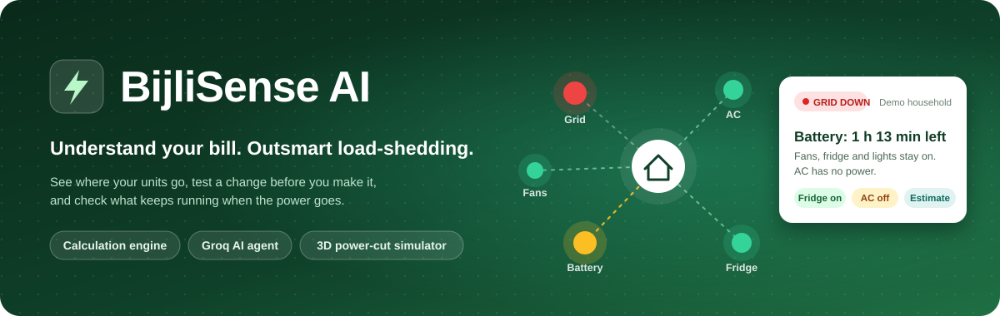
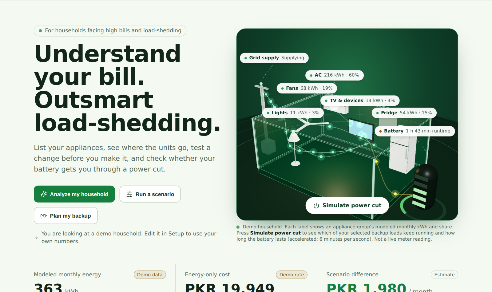
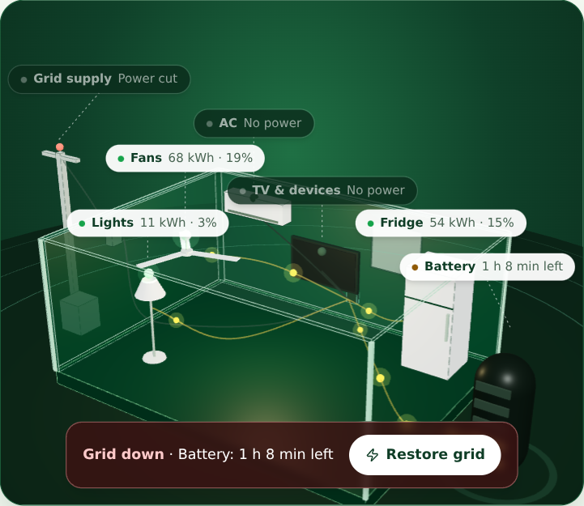
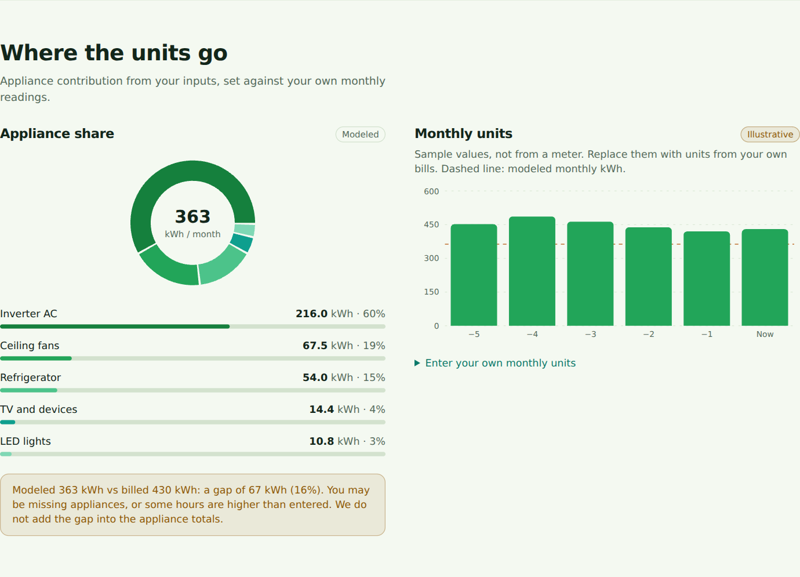
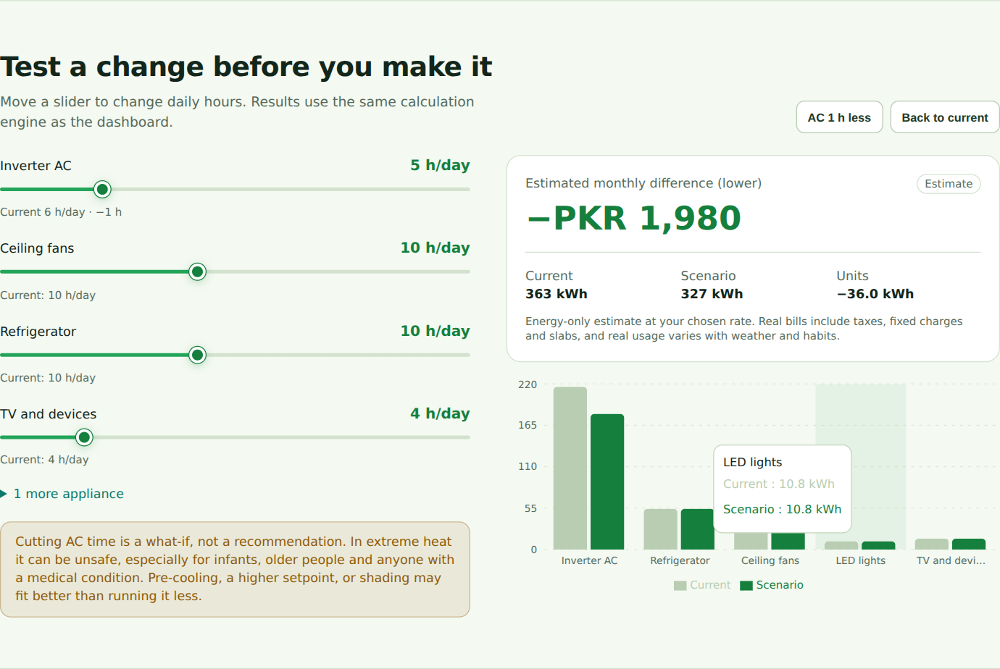
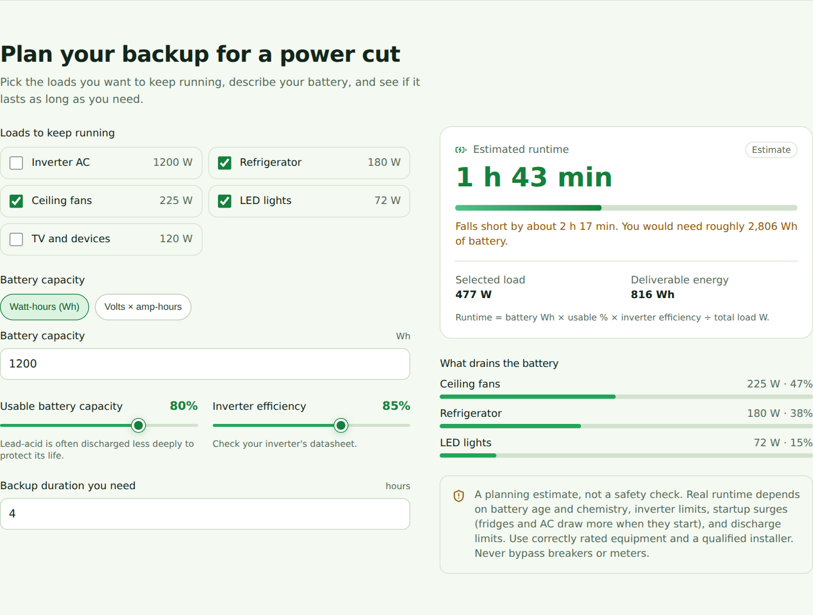
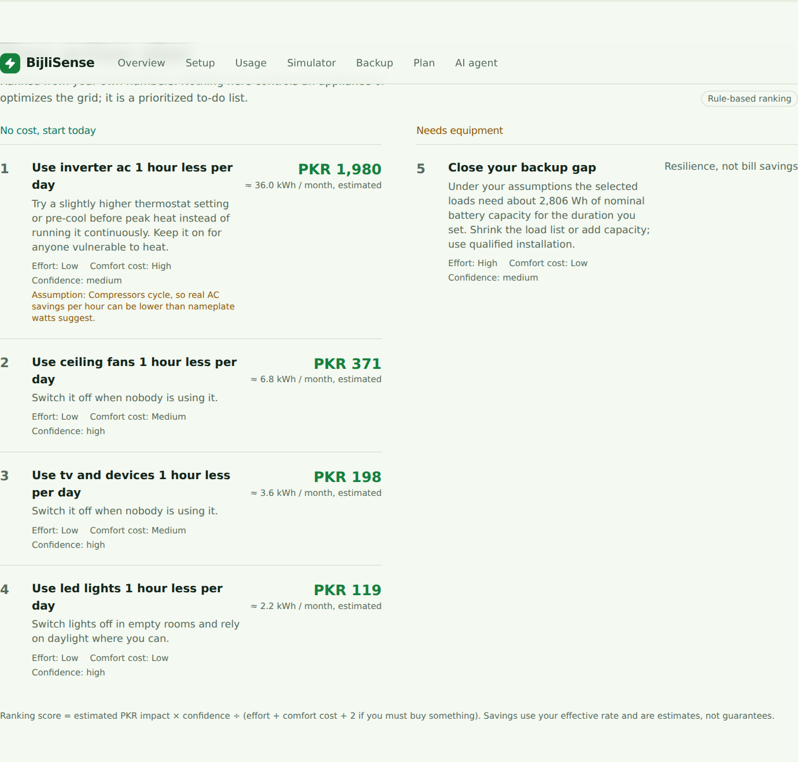
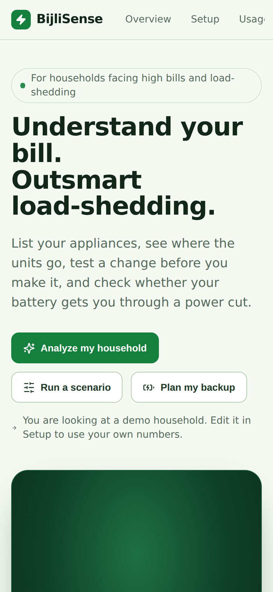
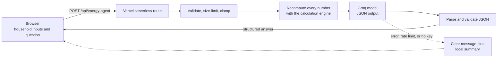

<p align="center">
  
</p>

<p align="center">
  
  
  
  
  
  
  
  
</p>

<h3 align="center">Understand your bill. Outsmart load-shedding.</h3>

<p align="center">
  List your appliances, see where the units go, test a change before you make it,<br>
  and watch what keeps running when the power goes out.
</p>

<p align="center">
  <a href="https://bijlisense-ai.vercel.app"><b>Live demo</b></a> ·
  <a href="#getting-started">Run locally</a> ·
  <a href="#how-the-ai-agent-works">AI architecture</a> ·
  <a href="#assumptions-and-limitations">Limitations</a>
</p>

---

## Table of contents

1. [Overview](#overview)
2. [What you get](#what-you-get)
3. [Screenshots](#screenshots)
4. [Features](#features)
5. [How the calculations work](#how-the-calculations-work)
6. [The power-cut simulation](#the-power-cut-simulation)
7. [How the AI agent works](#how-the-ai-agent-works)
8. [Tech stack](#tech-stack)
9. [Project structure](#project-structure)
10. [Getting started](#getting-started)
11. [Deploy to Vercel](#deploy-to-vercel)
12. [Security and privacy](#security-and-privacy)
13. [Assumptions and limitations](#assumptions-and-limitations)
14. [Testing](#testing)
15. [Roadmap](#roadmap)
16. [About](#about)

---

## Overview

Electricity bills in Pakistani households keep rising, air conditioning is the biggest single cost, and load-shedding makes it hard to know what a battery can actually carry. Most people cannot tell which appliance is responsible for the bill, or whether a UPS will last through the next power cut.

**BijliSense AI** (*bijli* means electricity in Urdu) is a web app that answers three practical questions:

| Question | Where it is answered |
|---|---|
| **Where do my units go?** | Appliance breakdown, a modeled-vs-billed gap check, and a 3D model of the home |
| **What happens if I change something?** | A what-if simulator driven by the same calculation engine |
| **What keeps running in a power cut, and for how long?** | A battery backup planner plus an interactive power-cut simulation |

An AI energy agent then reads the household's inputs and the calculated results and explains, in plain language, what to do first and what the trade-offs are.

> **The AI explains. The calculation engine computes.** Every number comes from deterministic, tested code. The language model is never asked to do the arithmetic.

BijliSense is **not** connected to a smart meter or a utility account. Everything is modeled from the inputs you enter, and the app says so wherever it matters.

## What you get

- Estimated monthly energy use in kWh and an energy-only cost in PKR.
- Each appliance's share of that use, with a check against your real bill units.
- A what-if difference in units and PKR for any change in daily hours.
- Battery runtime, whether it meets your required duration, how much it falls short, and which loads drain it.
- A ranked action plan split into no-cost actions and actions that need equipment.
- An AI answer with up to three prioritized actions, reasons, trade-offs, missing information, and limitations.
- Everything labelled as **demo data**, **your input**, **calculated**, or **AI-generated** so you always know what you are looking at.

## Screenshots

<p align="center">
  
</p>

<table>
  <tr>
    <td width="50%"><br><sub><b>Power-cut simulation.</b> Only the loads you selected for backup keep running.</sub></td>
    <td width="50%"><br><sub><b>Where the units go.</b> Appliance share, your own monthly readings, and the modeled-vs-billed gap.</sub></td>
  </tr>
  <tr>
    <td width="50%"><br><sub><b>What-if simulator.</b> Move a slider, see the difference in kWh and PKR immediately.</sub></td>
    <td width="50%"><br><sub><b>Backup planner.</b> Runtime, feasibility, shortfall, and the biggest drains.</sub></td>
  </tr>
  <tr>
    <td width="50%"><br><sub><b>Action plan.</b> No-cost actions first, equipment later, each with its assumptions.</sub></td>
    <td width="50%" align="center"><br><sub><b>Mobile.</b> The same app on a phone.</sub></td>
  </tr>
</table>

> The figures shown are from the built-in **demo household**, not real measurements.

## Features

| Section | What it does |
|---|---|
| **Overview** | Live totals with animated numbers, and a 3D cutaway home whose labels show each appliance group's modeled kWh and share. |
| **Household setup** | Add, edit, and remove appliances (name, watts, quantity, hours per day). Optional household size, billed units, bill amount, and your own PKR per kWh. Priorities: lower my bill, backup readiness, keep comfort first. Inline validation. |
| **Usage** | Donut and bar breakdown, six monthly readings you can enter yourself, and a reconciliation card that shows the gap between modeled and billed units instead of hiding it. |
| **Simulator** | Per-appliance daily-hour sliders. Results update instantly: modeled units, energy-only cost, difference from today, and a before/after chart. Reducing AC time shows a heat-safety warning. |
| **Backup planner** | Battery in Wh or in volts × amp-hours, usable capacity, inverter efficiency, required duration, and a selectable list of loads. Shows runtime, a feasibility verdict, the shortfall, and a contribution chart. |
| **Action plan** | Rule-based ranking by impact, confidence, effort, comfort cost, and whether you must buy something. |
| **AI energy agent** | Ask a question or press **Analyze my household**. Structured, validated, grounded in the calculations. If the AI is unavailable the page shows a local summary and everything else keeps working. |
| **Persistence** | Settings are saved in your browser only. **Reset demo data** and **Start empty** are one click away. |
| **Accessibility** | Labelled controls, visible focus, keyboard-operable sliders, readable contrast, and `prefers-reduced-motion` support. A 2D diagram replaces the 3D scene if WebGL is unavailable. |

## How the calculations work

All formulas live in [`lib/energy.ts`](lib/energy.ts) and are covered by unit tests.

**Appliance energy**

```
monthly kWh = watts × quantity × hours per day × 30 ÷ 1000
```

Inputs are clamped to sensible ranges (no negative values, at most 24 hours per day), so a typo can never produce a negative or `NaN` result.

**Energy-only cost**

```
cost (PKR) = monthly kWh × your effective PKR per kWh
```

This excludes taxes, fixed charges, tariff slabs, and fuel adjustments, and the interface says so.

**Modeled versus billed units**

If you enter the units on your last bill, BijliSense compares them with the appliance total. Within 10% it reports a close match. Beyond that it shows the gap and likely reasons (missing appliances, overstated hours) and **does not** add the gap into the appliance totals.

**What-if scenario**

The simulator recomputes every appliance with the hours you chose and reports `baseline − scenario` in kWh and PKR. A positive number means fewer units.

**Battery runtime**

```
runtime (h)  = battery Wh × usable fraction × inverter efficiency ÷ total load W
Wh (V × Ah)  = volts × amp-hours
required Wh  = load W × required hours ÷ (usable fraction × inverter efficiency)
```

If no load is selected the result is "no estimate", never `Infinity` or `NaN`.

**Action ranking**

```
score = (estimated PKR impact ÷ largest impact) × confidence weight × 10
        ÷ (effort + comfort cost + 2 if equipment must be bought)
```

Confidence weights are 1.0 (high), 0.75 (medium), and 0.5 (low). Savings are estimates from your own inputs, never guarantees.

## The power-cut simulation

Press **Simulate power cut** on the home page.

- The pole's status light turns red and the grid feed goes dark.
- Only appliances you ticked in the **Backup** section keep running. Everything else shows "No power".
- Amber energy lines flow from the battery, and the battery ring and cells drain.
- The countdown starts from your modeled runtime and runs at **6 simulated minutes per real second**.
- When the battery is empty everything goes dark. **Restore grid** resets the demo.

It is an illustration of the runtime formula above, not a live reading of a real battery.

## How the AI agent works



What the model receives: your appliance list, rate, scenario, and backup settings, the **server-recomputed** results, a list of missing information, and your question.

What it must return:

```json
{
  "insight": "Max two sentences.",
  "actions": [{ "title": "", "why": "", "impact": "", "tradeoff": "" }],
  "missingInfo": ["up to 3 items"],
  "limitations": ["up to 2 items"]
}
```

Guardrails:

- **Grounded numbers.** The server recomputes all results itself, so the model is never handed client-supplied "results" to repeat. The prompt tells it to quote only supplied numbers or label an assumption.
- **No invented data.** The model is told not to invent tariffs, load-shedding schedules, or savings.
- **Safety.** It must not present reduced AC use as safe in extreme heat, must not give electrical-safety guarantees, and must recommend qualified installation for hardware changes.
- **Prompt-injection resistance.** Appliance names and the question are treated as data, not instructions.
- **Validated output.** The response is parsed and clamped (at most three actions). If the model replies in plain text, it is shown and flagged as unstructured rather than failing.
- **Graceful failure.** A missing key, rate limit, bad model ID, or outage produces a plain-language error and a local summary. Calculations are never blocked by the AI.

Default model: `openai/gpt-oss-120b` (a production model in the Groq model list), configurable through `GROQ_MODEL`.

## Tech stack

| Layer | Choice |
|---|---|
| Framework | Next.js 14 (App Router) with TypeScript |
| Styling | Tailwind CSS with a small custom stylesheet |
| Charts | Recharts |
| 3D | three.js through `@react-three/fiber` (low-poly, no postprocessing) |
| AI | Groq SDK, called only from a serverless route |
| Hosting | Vercel (free tier) |
| Tests | Vitest |
| Data | None stored on a server. Browser `localStorage` only. |

## Project structure

```
app/
  page.tsx                     State, persistence, and section wiring
  layout.tsx, globals.css      Fonts, theme tokens, shared styles
  api/energy-agent/route.ts    Secure Groq endpoint
components/
  Overview.tsx, HeroScene.tsx  Hero, labels, power-cut control
  HouseScene.tsx               3D cutaway home (three.js)
  EnergyFlow.tsx               2D fallback if WebGL is unavailable
  Setup.tsx, Breakdown.tsx, Simulator.tsx, Backup.tsx, Plan.tsx, Agent.tsx, ui.tsx
lib/
  energy.ts                    Calculation engine (pure, tested)
  actions.ts                   Ranked action plan
  agent.ts                     Request validation, grounded payload, prompt, response parsing
  demo.ts                      Demo household and appliance presets
tests/                         Unit tests for the engine and the API route
docs/                          Banner and screenshots
```

## Getting started

**Requirements:** Node.js 20 or newer, and a free [Groq API key](https://console.groq.com/keys).

```bash
git clone https://github.com/Hamna-Munir/Bijlisense-AI.git
cd Bijlisense-AI
npm install
cp .env.example .env.local      # Windows: copy .env.example .env.local
```

Open `.env.local` and set your key:

```env
GROQ_API_KEY=your_groq_api_key
GROQ_MODEL=openai/gpt-oss-120b
```

Then:

```bash
npm run dev        # http://localhost:3000
npm test           # unit tests
npm run build      # production build
```

Without a key the app still runs. Only the AI agent shows a clear "not configured" message.

## Deploy to Vercel

1. Push the repository to GitHub. `.env.local` is git-ignored. Run `git status` before committing.
2. In Vercel choose **Add New → Project** and import the repository. Next.js is detected automatically.
3. Under **Environment Variables** add `GROQ_API_KEY` and `GROQ_MODEL`.
4. Click **Deploy**. If you add variables later, **Redeploy** so they take effect.
5. Open the live URL and press **Analyze my household** to confirm the AI responds.

## Security and privacy

- The Groq key lives only in `GROQ_API_KEY` and is read inside the serverless route. There are no `NEXT_PUBLIC_` secrets and nothing secret reaches the browser.
- The route validates types, clamps ranges, and rejects oversized or malformed requests: 20 KB body, 30 appliances, 600-character questions, plus a best-effort per-instance rate limit.
- Logs contain only an error status, never keys or payloads.
- **Sent to the AI provider:** appliance list, rate, scenario, backup settings, household size, and your question. **Not sent:** name, address, or any account details.
- No account is required. Settings are stored in your browser only, which is not a cloud account or a secure backup. The key is never stored in the browser.

## Assumptions and limitations

BijliSense is a planning aid. Please read these before trusting a number.

- **Modeled, not measured.** There is no smart-meter or utility integration.
- **Nameplate watts.** Real appliances cycle, so true use can differ, especially for AC compressors and refrigerators.
- **Energy-only cost.** Taxes, fixed charges, slabs, and fuel adjustments are not modeled. The rate is your own assumption, not an official tariff.
- **No official data.** The app contains no tariffs and no load-shedding schedules.
- **Demo values are illustrative.** Everything tagged "Demo data" is sample input until you edit it.
- **Backup runtime is simplified.** It ignores surge current, battery age and chemistry, and discharge limits. It is not an electrical safety check, so use correctly rated equipment and a qualified installer.
- **AI can still be wrong.** The prompt and server grounding reduce errors but cannot remove them. AI output is labelled, and the ranked plan is computed independently of it.
- **Presets are generic.** Use the wattage printed on your own appliance.

## Testing

```bash
npm test
```

28 unit tests cover:

- Zero usage gives zero kWh, and the formula matches hand calculations.
- Multiple appliances sum correctly, and negative or non-finite inputs are clamped.
- Changing a scenario changes the result, and increases are reported as negative savings.
- Modeled-versus-billed reconciliation, including a missing bill.
- Battery runtime, V × Ah conversion, feasibility, shortfall, and no `Infinity` or `NaN` for zero or invalid load.
- Action ranking order and empty-household handling.
- Request validation, size limits, grounded payload building, and response parsing (clean, fenced, wrapped, plain-text, and empty).
- The API route returns a clear error when the key is missing and rejects bad JSON or oversized bodies.

## Roadmap

- Import readings from a photo or CSV of a bill.
- Tariff slab support, once verified against official tariff documents.
- Urdu and Roman Urdu interface.
- A verified appliance database to replace generic presets.
- Optional solar and inverter sizing.
- Saved scenarios and shareable summaries.

## About

Built for the **Qubit Dynamics "Power. Water. Heat." hackathon** by **Hamna Munir** ([@Hamna-Munir](https://github.com/Hamna-Munir)).

Released under the [MIT License](LICENSE).
